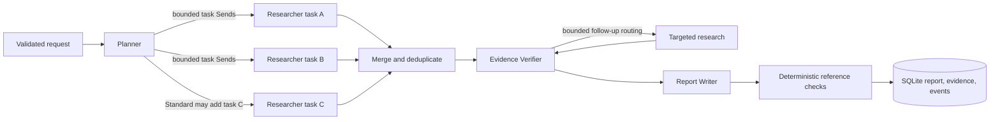

# Architecture

## Workflow

The current graph has an explicit conditional verifier route but deliberately routes directly to the writer; the output schema allows follow-up proposals, yet the current first version does not execute follow-up tasks. That keeps the implemented path finite. Four roles are useful because planning sets scope, researchers gather separate sources, the verifier compares claims with passages, and the writer synthesizes only assessed material. Merge, persistence, and integrity checks are ordinary code nodes, not extra agents.

## State And Routing

`backend/app/graph.py` defines a `TypedDict` shared state. `sources`, `evidence`, `candidates`, and workflow events use append reducers; each `Send` gives a researcher its assigned task, so tasks do not overwrite one shared evidence buffer. The merge node uses LangGraph `Overwrite` only after collecting all researcher updates. `RunBudget` reserves model/search/fetch requests under a thread lock. Researcher parallelism is capped at two even when Standard depth dispatches three tasks.

Live mode has four LLM-backed roles through a replaceable `RoleAdapter`: Pydantic structured output for Planner, bounded tool calling plus structured claim extraction for Researcher, structured ClaimAssessment-style verification, and structured Report output. The LangGraph state and persisted events contain only workflow results/statuses; no private chain-of-thought is requested or exposed. Demo uses the same graph with deterministic scripted output and inert adapters.

## Evidence Contract

Application code assigns IDs. A source records canonical URL, title, domain, UTC retrieval time, content type, normalized text, SHA-256 text hash, extraction status, and source-category basis. A passage stores an exact excerpt and half-open character offsets into that stored text. A failed fetch cannot create a source passage. The current category remains `unknown` unless a reviewed basis is supplied; an official-looking domain is not an accuracy guarantee.

The verifier may link support and contradiction separately. Application code clamps IDs to supplied candidates/passages, requires support for `supported`, and requires both support and contradiction for `conflicting`. The report sanitizer removes unknown references and replaces factual finding text with its assessed claim wording. This check blocks many structural fabrications, not semantic overstatement in a writer's synthesis. Human review remains necessary.

## Adapters And Storage

OpenAI calls use LangChain's OpenAI chat integration behind `RoleAdapter`; Tavily uses its `/search` endpoint directly, never Tavily's autonomous research product. The fetcher checks credential-free HTTP(S) URLs, DNS answers, and each redirect, disables automatic redirects and environment proxies, preserves TLS verification, and streams a byte cap. Beautiful Soup removes active markup and extracts plain text; pypdf handles bounded text PDFs. Parsing and SQLite work run off the async event loop. No OCR, browser automation, or raw HTML rendering is used.

SQLite stores run status/payload and cursor-addressable workflow events. Jobs are in-memory asyncio tasks limited to two active runs in one process. On startup, unfinished persisted rows become `interrupted`; they are not claimed to resume. Cancellation persists the latest graph update; an already in-flight remote request may still complete or be billed. SQLite is suitable for this local demo and may later be replaced by PostgreSQL with an explicit migration.

## API

`POST /api/research` returns 202 and a run ID. The browser polls `GET /api/research/{id}` and `GET /api/research/{id}/events?cursor=n`; it can cancel, list history, and export Markdown/JSON. `GET /api/config` reports mode and provider availability only. Local CORS is restricted to Vite localhost origins; Uvicorn instructions bind to loopback.
